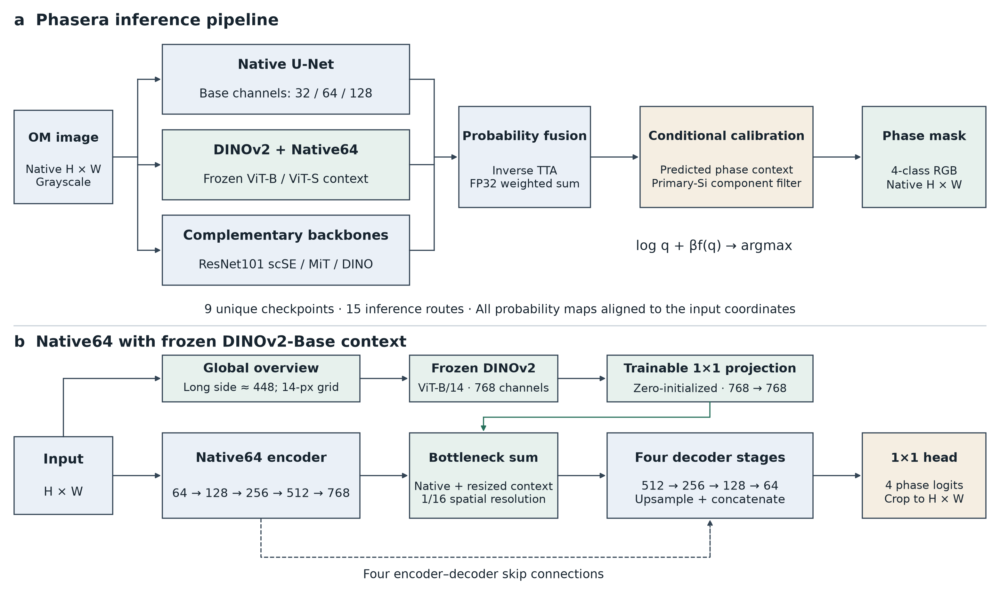

# Phasera · Microstructure Phase Segmentation

**KoMaP 2026 팀 프로젝트** · 고탄성 알루미늄 합금의 광학현미경 영상을 **Al, Primary Si, Al₃Ni, Eutectic Si** 네 상으로 픽셀 단위 분할합니다. 미세한 공정 Si 경계를 보존하면서 영상 전체의 조직 문맥을 반영하기 위해 원본 해상도 분할 모델과 동결 DINOv2 특징을 결합했습니다.

[모델링 요약](docs/modeling-summary.md) · [평가 코드](code/evaluate.py) · [검증 결과](results/oct09_final_results.json) · [예측 마스크](results/validation_predictions/)

| 개발 검증 IoU | 보정 단계 그룹 교차검증 | 최종 앙상블 |
| ---: | ---: | --- |
| **81.0665%** | 80.6410% | 체크포인트 9개 · 추론 경로 15개 |



## 데이터와 설계

대회에서 제공한 현미경 영상과 픽셀 라벨을 사용했습니다. 학습에는 70장, 개발 검증에는 20장을 사용했으며, 테스트 영상 10장은 마스크 생성에 사용했습니다. 개발 검증 세트에서 공정 Si는 전체 정답 픽셀의 7.66%를 차지했습니다. 가는 공정 Si 구조를 보존하려면 원본 해상도의 특징이 필요했고, 영상마다 상의 면적분율이 달라 예측 분포에 따른 보정을 적용했습니다.

## 방법

1. **원본 해상도와 전역 문맥 결합.** Native U-Net의 skip 연결로 세부 경계를 전달하고, 전체 영상의 동결 DINOv2 특징을 1×1 투영으로 변환해 bottleneck에 더합니다.
2. **확률 앙상블.** 체크포인트 9개를 서로 다른 스케일과 TTA 설정으로 실행하고, 15개 경로의 확률을 원본 좌표계로 복원해 결합합니다.
3. **조성 조건부 보정.** 영상별 예측 확률의 공간 평균에서 얻은 상별 분포로 9계수 log-offset을 계산합니다.
4. **선택적 성분 정제.** 영상 테두리에 닿지 않는 128픽셀 이하의 Primary Si 연결 성분을 다른 세 상 중 보정 점수가 가장 높은 상으로 재할당합니다.

## 검증 결과

각 영상에서 정답에 존재하는 상의 IoU를 평균한 뒤, 영상 20장의 점수를 동일 가중 평균했습니다.

| 구성 | 개발 검증 IoU |
| --- | ---: |
| 기본 앙상블 | 80.5277% |
| 조성 조건부 보정 및 선택적 정제 | **81.0665%** |

개발 검증 영상은 체크포인트·앙상블·보정 설정을 고르는 데 반복 사용했습니다. **81.0665%는 개발 검증 결과**이며, 80.6410%의 그룹 교차검증은 보정 단계에 한정됩니다.

## 저장소 구성

| 경로 | 내용 |
| --- | --- |
| [code/src/](code/src/) | 모델 구조, 학습 및 손실 함수 |
| [code/experiments/](code/experiments/) | 전역 문맥 결합, 학습 및 보정 비교 실험 |
| [code/inference/](code/inference/) | 추론, 조건부 보정, 연결 성분 정제 |
| [results/](results/) | 검증 통계와 검증 예측 PNG 20장 |
| [docs/](docs/) | 모델링 요약 및 구조도 |
| [third_party/](third_party/) | 외부 구성요소 출처와 고지 |

## 평가와 추론

제출 환경은 Linux x86_64, Python 3.12.3, PyTorch 2.8.0, CUDA 12.8입니다. 검증 점수를 다시 계산하려면 대회 제공 정답 마스크가 필요합니다. 평가 스크립트만 사용할 때는 NumPy와 Pillow를 설치하면 됩니다.

```bash
python -m pip install numpy pillow
python code/evaluate.py --predictions results/validation_predictions --masks /path/to/valid/masks --output validation.json
```

전체 GPU 추론에는 별도 제출된 호환 가중치 번들이 필요합니다. 번들의 `model_bundle/` 폴더를 저장소 최상위에 배치한 뒤 실행합니다.

```bash
conda env create -f environment.yml
conda activate komap-oct09
python run_phasera.py validate
python run_phasera.py predict --input /path/to/images --output /path/to/new_output
```

공개용 패키지에는 원본 대회 데이터, 정답 마스크, 테스트 제출 마스크, 가중치, 제출 실행 번들이 포함되어 있지 않습니다. 가중치 파일명과 SHA-256은 [가중치 목록](WEIGHTS_FILES.csv)에서 확인할 수 있습니다.
